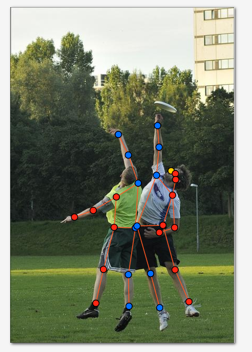
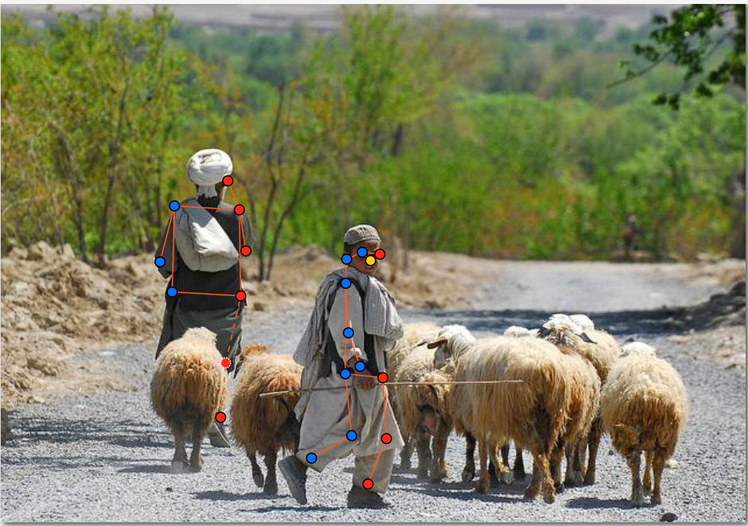
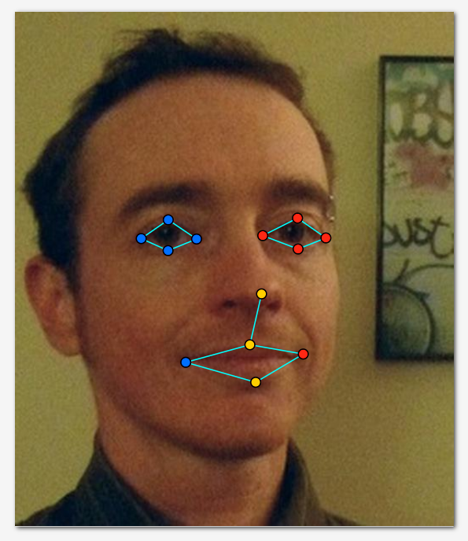
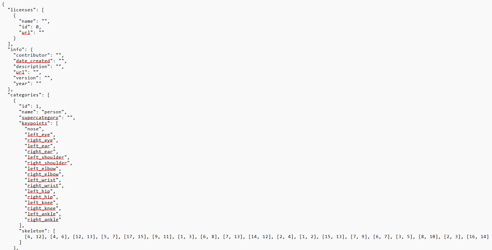

# Báo cáo cá nhân — Đoàn Thị ÁNh Hậu - 2A202603282

Dữ liệu: 12 ảnh người COCO val2017 (Lin et al., 2014) và 8 ảnh chân dung Wikimedia Commons, chỉ dùng trong lớp.

## 0. Thông tin học viên

- Họ tên: Đoàn THị Ánh Hậu
- MSSV: 2A202603282
- Email: 26ai.haudta@vinuni.edu.vn
- Link repository: https://github.com/DoanAnhHau/K5-L2-DAY04-DoanThiAnhHau-2A202603282-KeypointPose-Student
- Phiên bản CVAT (Help → About): 2.82.21
- Máy: hệ điều hành Windows · RAM 16 GB · chạy CVAT chế độ đầy đủ 
- Bộ ảnh (`src/exports/assignment.json` do `lab.py setup` tạo): có 
- Giờ bắt đầu: 16h30
- Giờ kết thúc: 18h25

## 1. Kiểm tra label (CP0)

| Label | Kiểu | Số điểm | Tên điểm đúng bảng của lab? | Đúng thứ tự? | Số cạnh |
|---|---|---:|---|---|---:|
| `person` | `skeleton` | 17 | Có | Có | 19 |
| `face` | `skeleton` | 13 | Có | Có | 13 |


Mẫu `person` dựng theo người quay mặt về camera (các điểm `left_*` nằm bên phải khung mẫu)? **Có**

Cách đổi cờ `occluded` / `outside` cho **một điểm** trên phiên bản CVAT này (một câu): Chọn đúng keypoint cần chỉnh trên skeleton, mở bảng thuộc tính bên phải (hoặc nhấp chuột phải vào điểm đó), rồi đổi thuộc tính `Visibility` từ mặc định sang `occluded` hoặc `outside`.

## 2. Số lượng đã gán và thời gian (CP1, CP2)

| Nhóm ảnh | Số ảnh | Số skeleton đã gán | Số người dưới 60 px (không gán) | Số poster / gương / màn hình bỏ qua | Thời gian (phút) |
|---|---:|---:|---:|---:|---:|
| `easy` | 5 | 6 | 0 | 0 | 18 |
| `occluded` | 3 | 5 | 0 | 0 | 17 |
| `back` | 2 | 3 | 1 | 0 | 12 |
| `small` | 1 | 2 | 2 | 0 | 6 |
| `crowd` | 1 | 2 | 3 | 0 | 7 |
| `faces` | 8 | 8 | — | 0 | 25 |

- Số ảnh người đã xong ở mốc phút 105: `12 / 12`
- Thời gian thực tế (phút): CP1 `60` · CP2 `25` · CP3 `20`
- Ảnh tốn thời gian nhất là ảnh nào, vì sao?
  Ảnh tốn thời gian nhất là `000000522889.jpg` và `000000508269.jpg` (thuộc nhóm `back` / `occluded` có tư thế xoay người và vắt chéo chân). Khi gán nhãn các ảnh này, nhân vật quay nghiêng hoặc quay lưng khiến việc phân biệt trái/phải (`left_*` / `right_*`) dễ nhầm lẫn, đồng thời phải kiểm tra lại nhiều lần sau khi script tự kiểm báo cảnh báo bắt chéo cặp `knee`, `ankle`.

## 3. Bảng ca khó (CP1, CP2)

Mỗi điểm bạn phân vân một dòng, nhất là phân vân giữa `v = 1` và `v = 0`, hoặc không chắc hướng người.

| Ảnh | Người / mặt | Điểm | Cờ đã chọn | Phân vân giữa | Lý do chọn |
|---|---|---|---:|---|---|
| `000000030960.jpg` | Người #2 (phía sau) | `left_hip`, `left_knee` | 1 | `v = 1` và `v = 0` | Vùng hông và đầu gối trái bị người phía trước che khuất một phần nhưng vẫn thấy rõ hướng thân trên và cẳng chân nên ước lượng được tâm khớp chắc chắn (`occluded`). |
| `000000122199.jpg` | Người #2 | `right_elbow` | 1 | `v = 1` và `v = 0` | Khuỷu tay phải bị che bởi cánh tay khác nhưng thấy rõ vị trí vai phải và cổ tay phải nên suy luận chính xác vị trí khớp khuỷu (`v = 1`). |
| `000000480582.jpg` | Người #1 | `left_ankle`, `right_ankle` | 0 | `v = 0` và `v = 1` | Hai cổ chân bị vật cản lớn che kín hoàn toàn và nằm sát mép dưới ảnh, không có cơ sở ước lượng chính xác nên đặt `outside` (`v = 0`) thay vì đoán bừa. |
| `face_324513.jpg` | Khuôn mặt #1 | `left_eye_outer`, `left_eye_lower`, `mouth_left` | 0 | `v = 0` và `v = 1` | Khuôn mặt quay góc nghiêng sâu làm nửa mặt trái khuất hẳn sau sống mũi và gò má, không đủ điểm tựa để đặt chắc chắn nên để `outside` (`v = 0`).

## 4. Bảng tự review (CP3)

| Ảnh | Người / mặt | Điểm | Mã lỗi | Ghi chú | Đã sửa? |
|---|---|---|---|---|---|
| `000000522889.jpg` | Người #2 (`back`) | `left_knee`, `right_knee`, `left_ankle`, `right_ankle` | `lr_swap` | Nhân vật quay lưng, phần thân trên gán đúng hướng nhưng cặp gối và cổ chân bị gán ngược trái/phải tạo đường nối bắt chéo chữ X; đã tráo lại đúng bên trái/phải của người. | Có |
| `000000508269.jpg` | Người #1 | `left_knee`, `right_knee`, `left_ankle`, `right_ankle` | `lr_swap` | Cặp gối và cổ chân nằm ngược chiều so với vai và hông do nhầm hướng chân bước; đã đổi lại `left_*` và `right_*` khớp với hướng cơ thể. | Có |
| `000000480582.jpg` | Người #1 (`crowd`) | Toàn bộ 17 điểm | `ok` | Hướng người và tên các điểm trái/phải chính xác, các khớp ngoài khung hình đều gán `outside` (`v = 0`). | — |
| `000000463932.jpg` | Người #1 (`easy`) | `left_hip`, `right_hip` | `position` | Điểm hông ban đầu đặt hơi cao lên phần cạp quần; đã kéo dịch xuống đúng tâm khớp hông theo hướng đùi. | Có |
| `000000210604.jpg` | Người #2 (`occluded`) | `right_wrist` | `vis_flag` | Cổ tay phải bị che khuất hoàn toàn sau lưng nhưng ban đầu để `v = 2`; đã chuyển sang `outside` (`v = 0`). | Có |
| `face_559185.jpg` | Khuôn mặt #1 | Toàn bộ 13 điểm | `ok` | Khuôn mặt nhìn thẳng rõ nét, 13 điểm đặt sát khóe mắt, mí mắt, chóp mũi và khóe miệng (`v = 2`). | — |
| `face_505385.jpg` | Khuôn mặt #1 | `left_eye_upper`, `right_eye_upper` | `position` | Điểm mí trên hơi lệch lên phía nếp mí khi chưa phóng to; đã zoom lớn và chỉnh lại đúng mép mí trên ngay trên tâm con ngươi. | Có |
| `face_342273.jpg` | Khuôn mặt #1 | Toàn bộ 13 điểm | `ok` | Đã kiểm tra phóng to từng điểm trên mắt, mũi, môi; tọa độ và cờ `v` đều chính xác. | — |

Tổng hợp số lỗi theo mã:

| `lr_swap` | `vis_flag` | `position` | `missing` | `extra` | `ok` |
|---:|---:|---:|---:|---:|---:|
| 2 | 1 | 2 | 0 | 0 | 3 |

Điểm còn phân vân giữa `v = 1` và `v = 0` (ghi cả hai lựa chọn và lý do chọn):
- Điểm `right_wrist` của Người #2 trong ảnh `000000210604.jpg`: phân vân giữa `v = 1` (ước lượng cổ tay đang đặt sau lưng) và `v = 0` (`outside`). Cuối cùng chọn `v = 0` vì cánh tay từ khuỷu trở xuống bị thân người che khuất hoàn toàn, không nhìn thấy bàn tay hay hướng cẳng tay nên nếu đặt `v = 1` sẽ mang tính đoán bừa và làm nhiễu dữ liệu huấn luyện.

## 5. Kiểm file xuất và kết quả tự kiểm (CP4)

Tự kiểm tay trong file JSON:

| File | Người / mặt kiểm (ảnh, thứ tự) | Số phần tử `keypoints` | Điểm `outside` ra `v = 0`, `occluded` ra `v = 1`? | `num_keypoints` khớp? |
|---|---|---:|---|---|
| `DoanThiAnhHau_persons.zip` | `000000508269.jpg`, người thứ 1 | 51 | Có | Có |
| `DoanThiAnhHau_persons.zip` | `000000522889.jpg`, người thứ 2 | 51 | Có | Có |
| `DoanThiAnhHau_faces.zip` | `face_559185.jpg`, mặt thứ 1 | 39 | Có | Có |

Sau khi xuất, CVAT ghi `occluded` thành `v = 1` và `outside` thành `v = 0`. Tọa độ của điểm `outside` trong file là **tọa độ cũ** (CVAT 2.82.1 giữ nguyên tọa độ cũ thay vì ghi `0, 0`, và các điểm `v = 0` này được bỏ qua khi huấn luyện và chấm điểm).

Hai job đã chuyển sang completed trên CVAT? **Có**

Dán phần **TÓM TẮT** in ra từ `src/check_submission.py`:

```text
- File person: DoanThiAnhHau_persons.zip
  Số ảnh: 12 · số skeleton `person`: 18 · mỗi annotation 51 số
  Skeleton theo ảnh: 000000030960=2, 000000078170=2, 000000122199=2, 000000201702=1, 000000210604=2, 000000390585=1, 000000431893=1, 000000438099=1, 000000463932=1, 000000480582=2, 000000508269=1, 000000522889=2
  Cờ v: v=2 230 (75%) · v=1 5 (2%) · v=0 71 (23%)
  num_keypoints trung bình: 13.1
- File face: DoanThiAnhHau_faces.zip
  Số ảnh: 8 · số skeleton `face`: 8 · mỗi annotation 39 số
  Skeleton theo ảnh: face_125051=1, face_141135=1, face_279764=1, face_324513=1, face_342273=1, face_505385=1, face_53580=1, face_559185=1
  Cờ v: v=2 92 (88%) · v=1 0 (0%) · v=0 12 (12%)
  num_keypoints trung bình: 11.5
- Ghi chú: 83 điểm v = 0 vẫn mang tọa độ cũ (CVAT 2.x xuất như vậy; chuẩn COCO ghi 0, 0). Không phải lỗi: điểm v = 0 bị bỏ qua khi huấn luyện và khi chấm.
- Số [LỖI]: 0 · số [CẢNH BÁO]: 0
Kết quả: ĐẠT
```

Các `[CẢNH BÁO]` còn giữ nguyên và lý do:
- Không còn cảnh báo nào giữ nguyên (`Số [CẢNH BÁO]: 0`). Hai cảnh báo xuất hiện ở lần chạy kiểm tra trước đó (`000000508269.jpg #1` và `000000522889.jpg #2` về việc cặp `knee, ankle` nằm ngược phía so với các cặp còn lại) đã được đối chiếu lại hướng nhân vật, sửa lỗi `lr_swap` và lưu lại (`Ctrl+S`) trước khi xuất file nộp cuối cùng.

## 6. Ảnh chụp màn hình

1. Label `person` trong label constructor (đủ 17 điểm có tên):

   

2. Một người quay lưng đã gán, cờ đã đặt:

   

3. Một khuôn mặt đã gán 13 điểm, phóng to vùng mắt:

   

4. Một đoạn JSON xuất của một người:

   

Nguồn ảnh: COCO val2017 / Wikimedia Commons.

## 7. Tự đánh giá

1. **Lỗi bạn mắc nhiều nhất hôm nay, và cách bạn sẽ tránh ở dự án thật:**
   Lỗi mắc nhiều nhất là `lr_swap` ở chi dưới (cặp `knee`, `ankle`) khi nhân vật quay lưng hoặc xoay người nghiêng. Ở dự án thật, để tránh lỗi này tôi sẽ luôn xác định và gọi tên hướng quay của người trước khi đặt điểm, tự đối chiếu tư thế cơ thể của mình với nhân vật, và kiểm tra trực quan các đường nối (edges) xem có đoạn nối nào bắt chéo chữ X bất thường giữa hai chân hoặc hai tay hay không trước khi chuyển ảnh.

2. **Một quy tắc bạn đề xuất thêm vào guideline (kèm ảnh ví dụ nếu có):**
   Nên bổ sung quy tắc kiểm tra đối xứng trục ngang cho các cặp khớp đối xứng (`shoulder`, `hip`, `knee`, `ankle`): sau khi kéo xong bộ khung skeleton trên CVAT, người gán bắt buộc phải quan sát riêng 4 đường nối dọc thân và chi dưới (`[6,12]`, `[7,13]`, `[12,14]`, `[13,15]`, `[14,16]`, `[15,17]`); nếu có đường bắt chéo phải xác nhận rõ nhân vật đang thực sự vắt chéo chân/tay trước khi lưu.

3. **Nhãn của bạn đi vào model ở đâu? Chọn một lỗi bạn đã sửa và nói nó sẽ làm model học sai thế nào (heatmap, trọng số trong loss, hay bước lật ảnh):**
   Trong huấn luyện bài toán Keypoint/Pose Estimation, tọa độ các điểm có `v > 0` được dùng để tạo ra các bản đồ nhiệt Gaussian (ground-truth heatmaps) tương ứng với từng kênh khớp, còn điểm `v = 0` có trọng số bằng 0 trong hàm loss. Khi mắc lỗi `lr_swap` ở cặp `knee` và `ankle` (như ở ảnh `000000508269.jpg`), đỉnh Gaussian trên heatmap của kênh `left_knee`/`left_ankle` sẽ bị đặt nhầm sang chân phải. Đồng thời, trong bước tăng cường dữ liệu lật ngang ảnh (horizontal flip) vốn tự động hoán đổi nhãn `left_*` ↔ `right_*`, mẫu dữ liệu bị gán ngược này sẽ cung cấp tín hiệu giám sát trái ngược với toàn bộ tập dữ liệu đúng, khiến hàm loss dao động và làm model dự đoán nhầm lẫn hoặc phân tán xác suất giữa hai bên chân.

## 8. Khó khăn và lỗi kỹ thuật

- **Quên lưu thay đổi trên CVAT trước khi xuất file:** Sau khi chỉnh sửa vị trí các điểm bị `lr_swap`, nếu chưa nhấn `Ctrl+S` để lưu lên server của CVAT 2.82.1 thì file ZIP xuất ra vẫn giữ tọa độ cũ, dẫn đến việc chạy `src/check_submission.py` vẫn báo lại cảnh báo cũ.
- **Phân biệt thuộc tính `hidden` và `occluded`/`outside`:** Cần chú ý chỉ chỉnh cờ qua thuộc tính `Visibility` của từng keypoint chứ không dùng phím tắt `H` (`hidden`), vì `hidden` chỉ ẩn điểm trên giao diện hiển thị mà không làm thay đổi giá trị `v = 2` khi xuất JSON.

## 9. Tài liệu tham khảo và công cụ AI đã dùng

- **Tài liệu tham khảo:** Tài liệu *Quy ước nhãn — Lab Ngày 4 (Keypoint & Pose)*; tài liệu chuẩn dữ liệu COCO Keypoints Detection (Lin et al., 2014); tài liệu hướng dẫn thao tác trên CVAT 2.82.
- **Công cụ AI đã dùng:** Sử dụng Gemini để rà soát lỗi cấu trúc báo cáo, đối chiếu logic phân tích nguyên nhân cảnh báo `lr_swap` từ script tự kiểm và kiểm tra tính nhất quán giữa số liệu trong file JSON với nội dung trình bày.
